# DevilishDagon — Projects & experiments

DevilishDagon is an alias I use for privacy reasons.

**[Explore the portfolio](https://devilishdagon.github.io/portfolio/)** · [GitHub profile](https://github.com/DevilishDagon)

33 projects, including 8 detailed case studies. The directory covers 23 GitHub repositories plus local projects. Private application source stays private. Latest substantive source review: 2026-10-27.

Every gallery image has a type, date and caption. Real screenshots, fictional-data demonstrations, original artwork, diagrams and retained documentation previews are distinguished. See [image provenance](CAPTURES.md).

## Selected work

- [Metis](https://devilishdagon.github.io/portfolio/#project=metis) — A personal companion that carries context into everyday action.
- [Mnemosyne · The Long Way Home](https://devilishdagon.github.io/portfolio/#project=mnemosyne) — A persistent memory and operating system for a living campaign.
- [XBNL Performance Dashboard](https://devilishdagon.github.io/portfolio/#project=kpi-dashboard) — From scattered operational sources to a readable performance workspace.
- [SheetParcel](https://devilishdagon.github.io/portfolio/#project=sheetparcel) — One spreadsheet. A properly priced PDF for every customer.
- [Contractstudio](https://devilishdagon.github.io/portfolio/#project=contractstudio) — Maintenance contracts, assembled with care.
- [Cerberus · Pico Desk Companion](https://devilishdagon.github.io/portfolio/#project=cerberus) — Three heads, a little personality, and no chores.
- [Pico OLED Companion](https://devilishdagon.github.io/portfolio/#project=pico-display) — A tiny display with a useful sense of time.
- [Hades Remote](https://devilishdagon.github.io/portfolio/#project=hades-remote) — A theatrical animation, delivered through a controlled device channel.

## Project directory

## Metis

Metis brings conversation, planning, reminders, personal memory and wellbeing into a native iPhone workspace. The current app is organized around Today, Plan, Ask, Care and Me, backed by a Python service that keeps actions tied to the records and permissions behind them.

**Type:** Personal companion · native iOS + Python backend · **Technologies:** SwiftUI, Python, Flask, SQLite, HealthKit, EventKit

Source reviewed: 2026-10-27.

### The problem

Useful personal context is scattered across conversations, calendars, reminders and separate health or planning tools. A chat window alone does not turn that context into dependable follow-through. Metis is built to connect those pieces while keeping the owner in control of what becomes a saved fact, a reminder or a calendar change.

### The experience

Today presents a small selection of relevant items instead of an endless feed. A task can be completed, a reminder snoozed, or a suggestion hidden for the day; those actions deliberately mean different things. Plan brings together appointments, commitments, people and project work. Ask provides conversation with retained context, Care groups health and medication features, and Me gives a customizable personal overview with access to the wider feature library.

### How it is built

The SwiftUI client talks to a Flask mobile API. SQLite stores durable records and request receipts, while background jobs handle agreed follow-ups and synchronization. Calendar and project edits proposed in conversation are reviewed before application. Persistent request identifiers make retries safe, revision checks reject stale actions, and the mobile queue distinguishes cached content and unconfirmed changes from acknowledged results.

### Current focus

Recent work adds actionable Today cards, category preferences, preparation for tomorrow, configurable Me cards and project follow-through. The latest inspected native source uses Today, Plan, Ask, Care and Me. Health and Finance are personal organizational tools, not medical advice or proof of banking availability. This review checks source behavior; it does not claim a new App Store release, a physical-device test or a successful push delivery.

**Capabilities**

- A focused Today view with completion, snooze, hide and preference controls
- Reviewable calendar and project changes from conversation
- Tomorrow preparation with evidence and calendar freshness
- Inspectable memory, projects, people and personal preferences
- Offline action queue, replay protection and guarded undo
- HealthKit, medication and Finance workspaces

[Open project details](https://devilishdagon.github.io/portfolio/#project=metis)

The former web HUD is no longer used to represent the current product. These source-grounded diagrams explain the current native app and action flow; they are not iPhone screenshots. A recent, sanitized device capture is still needed.

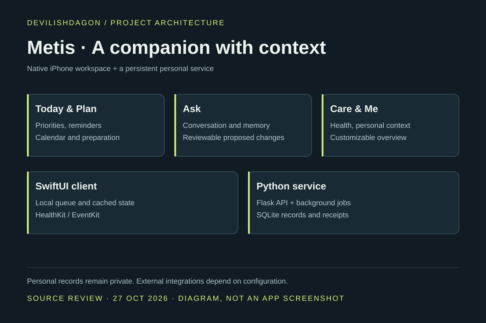

*Architecture diagram · 2026-10-27. Current native app areas and the supporting service. Diagram, not an app screenshot.*

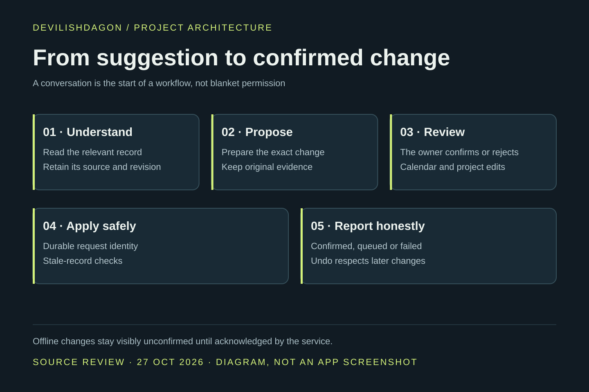

*Workflow diagram · 2026-10-27. A proposed change passes through review, durable receipts and a guarded result. Diagram, not an app screenshot.*

## Mnemosyne · The Long Way Home

Mnemosyne is the assistant-DM, archivist and railway bot behind The Long Way Home, an asynchronous Discord roleplaying campaign. It connects original scene evidence, a human-maintained Obsidian vault and persistent runtime state, while separating private preparation from player-facing information.

**Type:** Private application · **Technologies:** Python, Discord.py, SQLite

Source reviewed: 2026-10-27.

### The challenge

A long-running asynchronous campaign accumulates more than lore: there are conversations, character beliefs, unfinished scenes, travel constraints and private plans. Mnemosyne helps the DM recover the right context without flattening uncertainty or treating every statement as an objective fact. Original attribution and the distinction between evidence and suggestion are central to the design.

### A workspace for the DM

The private DM desk supports questions, scene preparation, recall and continuity checks. Ongoing writing projects can retain alternatives, accepted lines and revisions across restarts. A briefing surfaces a small set of material items, while an inbox holds drafts and suggestions for review. Approving a draft does not automatically publish roleplay, and generated ideas do not become canon on their own.

### Memory with boundaries

Discord ingestion follows the configured RP watchlist and keeps child threads as separate scenes. Reconciliation can recover missed messages, while source links preserve a route back to the original evidence. SQLite holds runtime state and the Obsidian vault remains the human-readable knowledge base. Player retrieval checks access, private thread evidence is excluded from public boards, and secret material stays outside player-facing outputs.

### Beyond conversation

The same project runs deterministic campaign services: railway displays, a live-map overlay, travel context and the day/night cycle. This combination makes it a substantial systems project as well as a narrative tool. The image gallery includes the current map asset and an architecture diagram, not private Discord conversations or unreleased campaign secrets. The map is project artwork retained from September, reviewed again for this update.

**Capabilities**

- Discord scene and thread archival with original evidence links
- Private research, preparation, recall and continuity checks
- Persistent creative projects, alternatives, revisions and editorial preferences
- Railway schedules, map overlays and day/night displays
- Approval queues for suggestions and NPC drafts
- Audience-aware retrieval and controlled vault synchronization

[Open project details](https://devilishdagon.github.io/portfolio/#project=mnemosyne)

Original campaign railway artwork plus a public-safe architecture diagram. No private roleplay, player messages or DM secrets are shown.

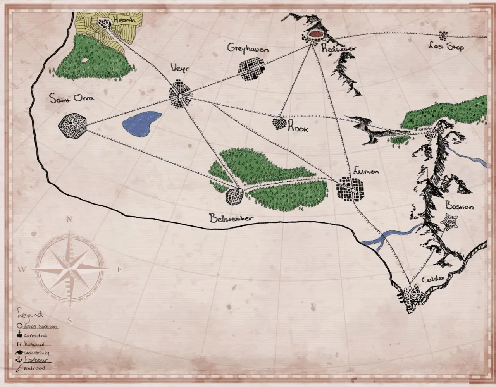

*Project artwork · 2026-09-01. Current campaign railway map asset; original artwork dated 1 September 2026.*

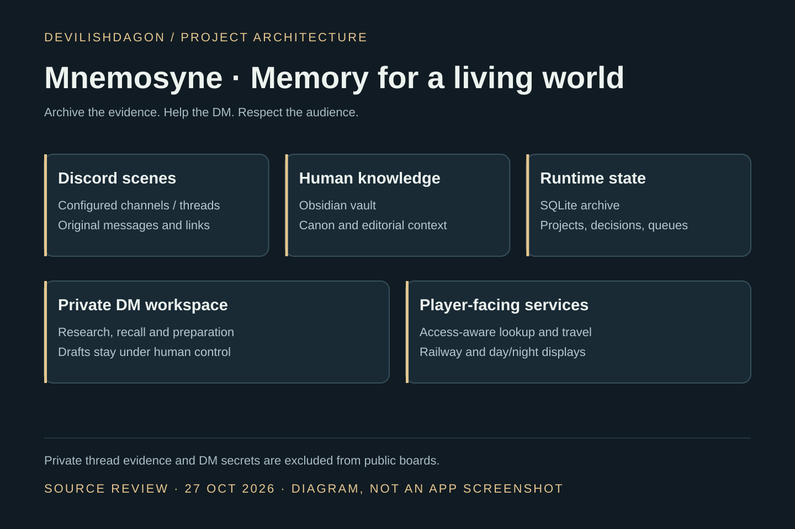

*Architecture diagram · 2026-10-27. Archive, private preparation and public outputs remain separate. Diagram, not a Discord screenshot.*

## XBNL Performance Dashboard

A private Xylem performance dashboard spanning ten business sectors and 32 report screens. It combines read-only source integrations, carefully scoped maintenance reporting, sales and quotation views, record exploration and explicit freshness states in a single responsive interface.

**Type:** Private operational dashboard · **Technologies:** JavaScript, Cloudflare Workers, D1 / SQLite, XDM, Archie

Source reviewed: 2026-10-27.

### The problem

Business reporting spans maintenance records, CRM activity, quotations and workbook definitions. A useful dashboard needs to make those sources easier to navigate without silently inventing missing measures or confusing a raw record count with a business outcome. The project therefore treats source scope, definitions and freshness as part of the product.

### The workspace

The current interface has a sector sidebar, report tabs and a keyboard-accessible finder across 32 reports. Maintenance views combine scoped totals with an interactive status chart and a searchable record explorer. Related work covers sales activity, quotations, lead times, follow-ups and workbook-backed reporting. Appearance settings and responsive layouts support both desk and mobile use.

### Data integrity

Read-only XDM and Archie adapters feed stored snapshots. Maintenance totals use the defined managed-contract scope; records needing a responsibility review are kept separate from the headline KPI. Partial or failed refreshes do not replace the last complete snapshot. Missing inputs remain visible as unavailable. Filtering, sorting and export operate on the selected saved population, with CSV formula protection and context retained in exports.

### Recent development

The 27 October interface refresh simplifies the page hierarchy and keeps the operational controls close to the reports. Other recent work adds the report finder, more reliable filtering, maintenance exports and clearer source behavior. The portfolio screenshots run this current frontend with fictional totals and no live connectors. They demonstrate the interface, not company performance, customer records or a claim that every KPI has a verified data source.

**Capabilities**

- Ten sectors and a keyboard-accessible finder for 32 report screens
- Scoped maintenance totals with interactive status exploration
- Quotation, sales, follow-up and lead-time views
- Search, filters, pagination and formula-safe CSV exports
- Complete-snapshot publication and source freshness states
- Responsive navigation, dark mode and a separate fictional-data demo

[Open project details](https://devilishdagon.github.io/portfolio/#project=kpi-dashboard)

Captured 27 October 2026 from the current production frontend in an isolated local instance. All totals are fictional fixtures; employee names and internal links were removed from the capture copy. No live customer or sales data is included.

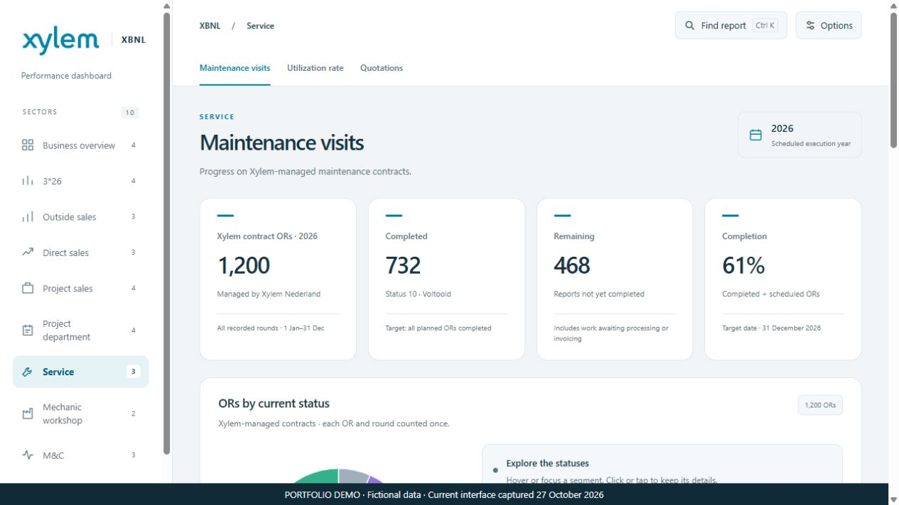

*Application screenshot · 2026-10-27. Current maintenance interface with fictional totals and no live connectors.*

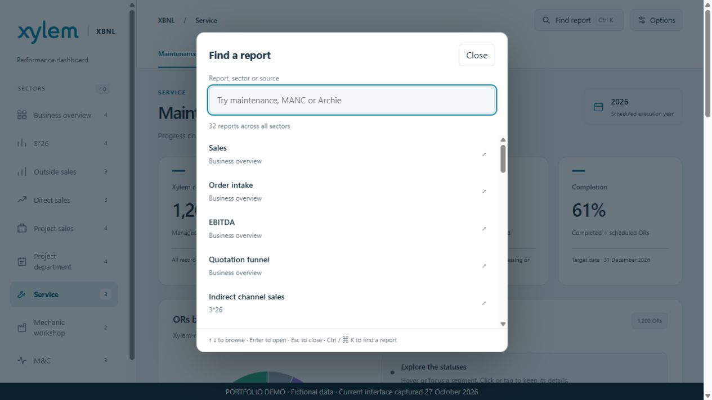

*Application screenshot · 2026-10-27. Current report finder across 32 reports; isolated capture with no company records.*

## SheetParcel

SheetParcel turns prepared Excel or CSV rows into branded customer-specific PDF price sheets. It handles column matching, discounts, validation, document layout and batch ZIP export locally in the browser, with a public demo and a downloadable offline edition.

**Type:** Released offline utility + public demo · **Technologies:** JavaScript, SheetJS, jsPDF

Source reviewed: 2026-10-27.

### The job it replaces

Suppliers often already know their prices but still copy the same products into separate customer documents. SheetParcel focuses on that repetitive document step. The input is a prepared table with one row per customer and product; the output is a reviewable price sheet for each customer, using that customer’s supplied discount.

### From rows to documents

The user imports an XLSX or CSV file, chooses the worksheet and maps the columns. Branding controls set the business name, logo, colour, currency and document language. The preview switches between customers, while validation flags unsupported or ambiguous inputs before export. Price calculations use deliberate decimal handling so the number shown in the PDF matches the selected discount and rounding rules.

### A local-first product

Spreadsheet contents, logos and generated documents are processed on the device. The purchased edition opens as a standalone HTML application, with no server or account needed to use it. A separate public demo previews all example customers and exports the first customer with a demo footer. The full edition exports the batch as a ZIP with named PDFs.

### Current scope

The refreshed public site includes a worked example, an interactive price walkthrough and help preparing a small fictional sample. SheetParcel supports English and Dutch PDF layouts and publishes clear input limits. It is a price-sheet tool: it does not calculate VAT, issue invoices, join separate customer/product tables, synchronize inventory or send email. The gallery shows the current public site and its real demo using bundled fictional customers.

**Capabilities**

- Excel / CSV import with explicit column matching
- Customer grouping and precise per-line discount rounding
- Branding, currencies and English / Dutch document layouts
- Validation for missing inputs, formulas and conflicting customer details
- PDF previews and complete-batch ZIP export in the paid edition
- Public example walkthrough, free demo and offline delivery

[Open project details](https://devilishdagon.github.io/portfolio/#project=sheetparcel) · [Visit project](https://sheetparcel.com)

Screenshots captured from sheetparcel.com and its working demo on 27 October 2026. The demo uses bundled fictional example rows. Product imagery is from the actual application.

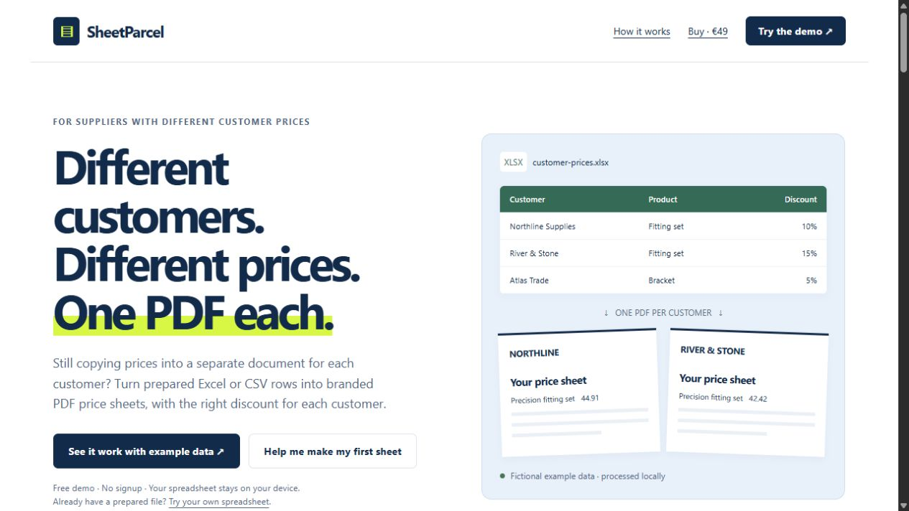

*Live website screenshot · 2026-10-27. Current sheetparcel.com storefront.*

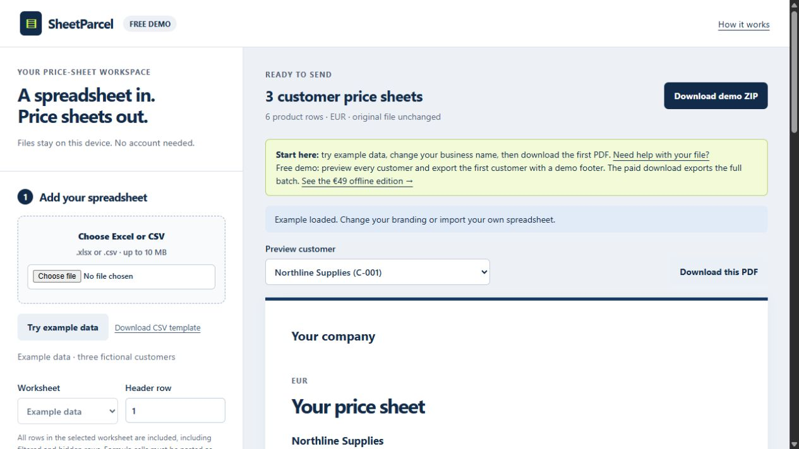

*Application screenshot · 2026-10-27. The working public demo with its three fictional example customers.*

## Contractstudio

Contractstudio is a guided Dutch workspace for assembling maintenance agreements. Five steps connect customer details, maintenance scope, optional services, pricing and review to the same paginated document model used for the live preview and PDF export.

**Type:** Browser prototype · fictional examples · **Technologies:** JavaScript, PDF-lib, HTML/CSS

Source reviewed: 2026-10-27.

### A document workflow with rules

A maintenance agreement is more than a collection of form fields. The selected maintenance work, service coverage, quantities and conditions must agree with the wording and prices in the final document. Contractstudio makes that assembly process visible through a guided editor and a page-by-page preview.

### What the user controls

The five-step flow moves from customer and project information to maintenance, a service menu, prices and a final review. Optional services cover cleaning, connectivity, breakdown arrangements, supervision, response terms and planned overhaul. Services can be priced individually or covered by an annual package, with schedules and coverage requirements recorded alongside them.

### One model for preview and export

A normalized contract object feeds a shared document drawing model. The browser renders that model as SVG for the live preview and as a vector PDF with embedded fonts for export. Conditional content follows the selected scope, and integer-cent calculations keep the document totals consistent with the editor. Missing prices are not silently treated as zero.

### Honest prototype boundaries

Incomplete service terms produce an explicitly marked concept with open points and no signature block. The prototype uses fictional customer data, stores entries only in page memory and has no live business-record integration. Portfolio captures also substitute invented tariffs. Final source ownership, approved pricing rules, persistence and access control remain requirements for a production rollout.

**Capabilities**

- Five-step customer, maintenance, service, pricing and review workflow
- Optional service menu with schedules and coverage requirements
- Separate service pricing or a fixed annual package
- Shared drawing model for SVG preview and vector PDF export
- Conditional clauses, NEN scope and installation terms
- Concept documents with explicit open points when terms are incomplete

[Open project details](https://devilishdagon.github.io/portfolio/#project=contractstudio)

Current local prototype captured 27 October 2026. Fictional customer information and invented tariffs were used in the capture copy. The production source was not modified.

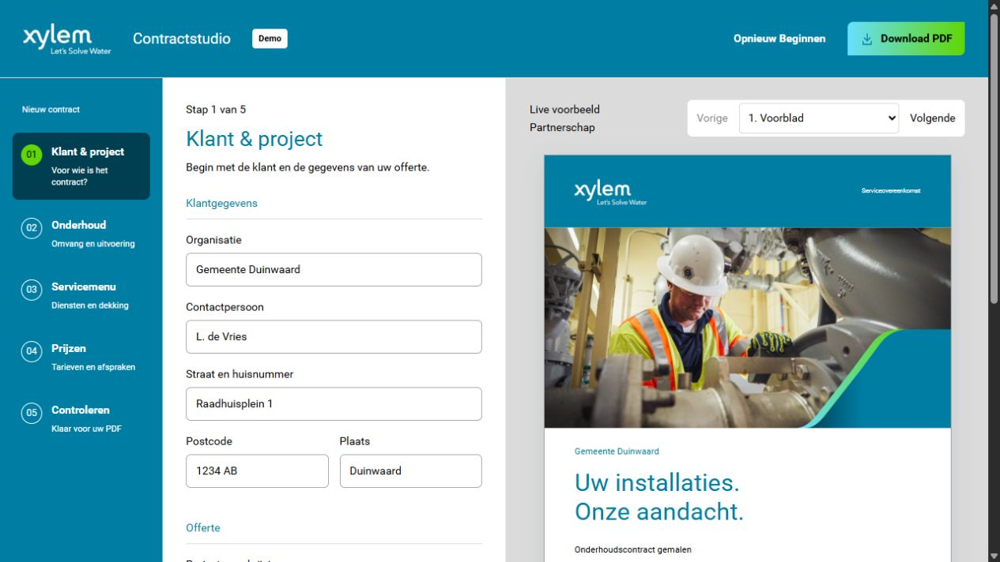

*Application screenshot · 2026-10-27. Customer editor and live PDF preview with fictional customer data and invented tariffs.*

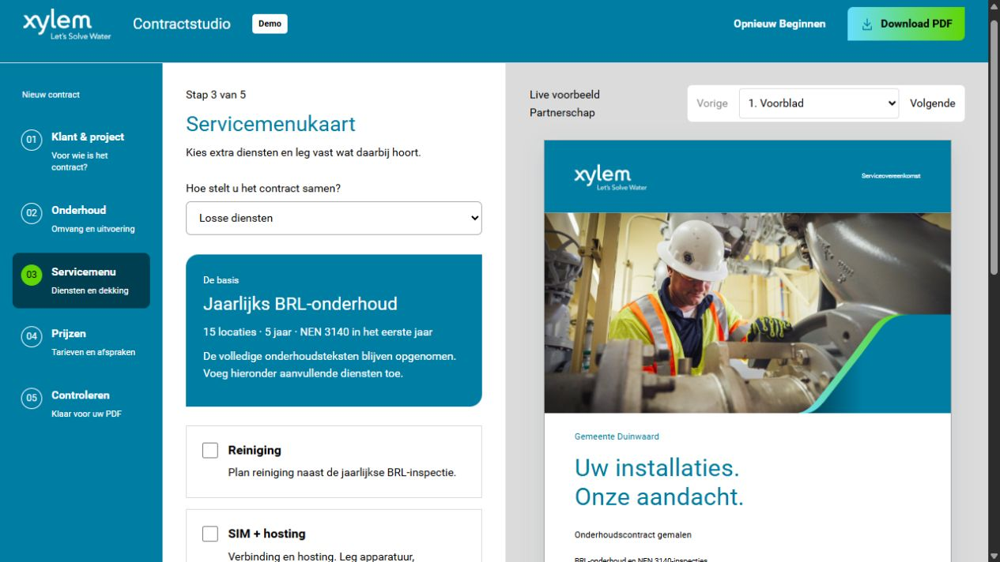

*Application screenshot · 2026-10-27. The current service-menu workflow in the isolated prototype.*

## Cerberus · Pico Desk Companion

A procedural three-headed pixel companion for the Pico OLED. A small Windows helper sends coarse local activity states over USB, allowing the firmware to react with curiosity, play, rest and occasional surprises without recording what the person is doing.

**Type:** Packaged prototype · hardware validation pending · **Technologies:** MicroPython, Python, USB serial, SSD1309 OLED

Source reviewed: 2026-10-27.

### The idea

Cerberus turns the existing Pico display into a small desk companion. The three heads have different reactions, but there is no feeding system, streak, health bar or obligation to look after it. The experience is intended to be enjoyable background company rather than another task to maintain.

### Procedural character

The 1.0.0 package combines 48 behaviors and events with three leading heads and four reaction styles, yielding 576 choreographed variants. Episodes have an arrival, reaction and resolution. Random quiet gaps, cooldowns and recent-action avoidance keep the display from repeating one animation on a rigid timer. Sleep narrows the repertoire, and returning from a break can trigger a greeting.

### Privacy by construction

A local Windows helper uses idle-time information to estimate broad active and resting states, then sends a small mood/focus message over the existing USB serial connection. It does not transmit typed text, application names, screenshots, URLs or browsing history. Reading or watching a meeting can resemble inactivity, so this is a coarse interaction cue rather than productivity measurement.

### Current state

The latest available package and original animation assets are version 1.0.0 from 21 October 2026. The host rendering and package work were validated separately from physical hardware. The gallery contains the actual behavior sheet and firmware-rendered animation; it does not imply that a Pico was connected or updated during this portfolio refresh.

**Capabilities**

- 48 behaviors × 3 leading heads × 4 reaction styles
- Coarse local activity and break awareness
- Random quiet gaps and recent-action avoidance
- Sleep and return greetings without persistent care tasks
- Local-only pet mode with no app names, keystrokes or browsing history

[Open project details](https://devilishdagon.github.io/portfolio/#project=cerberus)

Original 1.0.0 behavior sheet and firmware-rendered GIF, produced 21 October 2026 and reviewed 27 October. These are rendered assets, not device photographs.

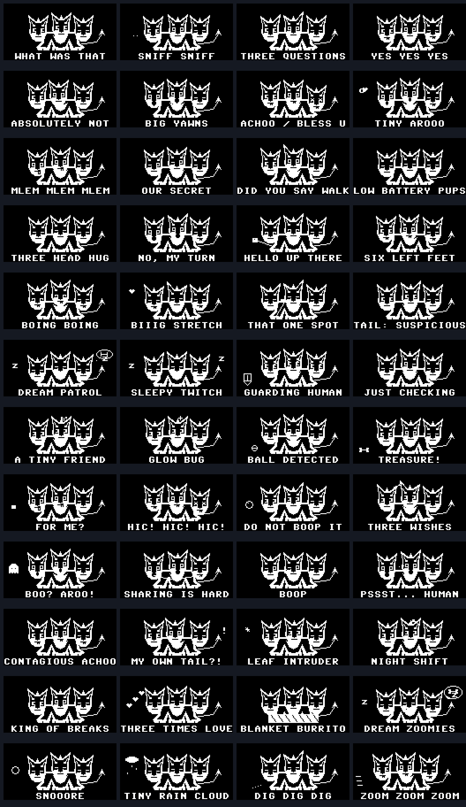

*Firmware-rendered artwork · 2026-10-21. Behavior sheet from the original 1.0.0 package.*

[View animation](assets/screenshots/cerberus-animation.gif)

*Firmware animation · 2026-10-21. Original procedural animation preview. Motion can be enabled in the gallery.*

## Pico OLED Companion

A Raspberry Pi Pico 2 W and monochrome OLED project that makes small pieces of desktop information visible on a dedicated physical display. The firmware combines quota/status pages, a local clock and solar information with USB-assisted recovery and explicit stale or unavailable states.

**Type:** Hardware project · **Technologies:** MicroPython, Pico 2 W, OLED

Source reviewed: 2026-10-27.

### A glanceable physical interface

The aim is to put compact, useful information on a small desk display without turning it into another full application window. MicroPython firmware drives a 128 × 64 monochrome OLED, balancing large readable values with secondary context. Different pages serve quota/status, time and solar information.

### Resilience on constrained hardware

The project includes USB helper and recovery workflows alongside standalone network behavior. Missing or expired data is treated as unavailable or stale instead of becoming a false zero. Firmware packages are staged and verified during installation, and saved device configuration needs to survive updates. The compact monochrome layout prioritizes the current value and its freshness, with secondary information placed on separate pages.

### A growing hardware platform

Later work builds on the same Pico and OLED setup for a local activity-reactive Cerberus companion, presented as its own project in this portfolio. That makes the original display a platform for both practical telemetry and playful interaction. The two projects have different data paths: a local pet mode does not imply that every quota-display mode is offline.

### What the pictures prove

The retained display images were rendered by the firmware tooling on 30 September 2026. They show the original page designs and are labelled historical firmware previews. They are not new device photographs, evidence of today’s account allowance, or proof that the latest package has been installed on connected hardware.

**Capabilities**

- Allowance telemetry with unavailable-data states
- Solar and clock display layouts
- Local setup and USB recovery tools

[Open project details](https://devilishdagon.github.io/portfolio/#project=pico-display)

Historical firmware-rendered previews from 30 September 2026, reviewed for this update. No recent physical-device photograph is available. See Cerberus for the newer companion artwork.

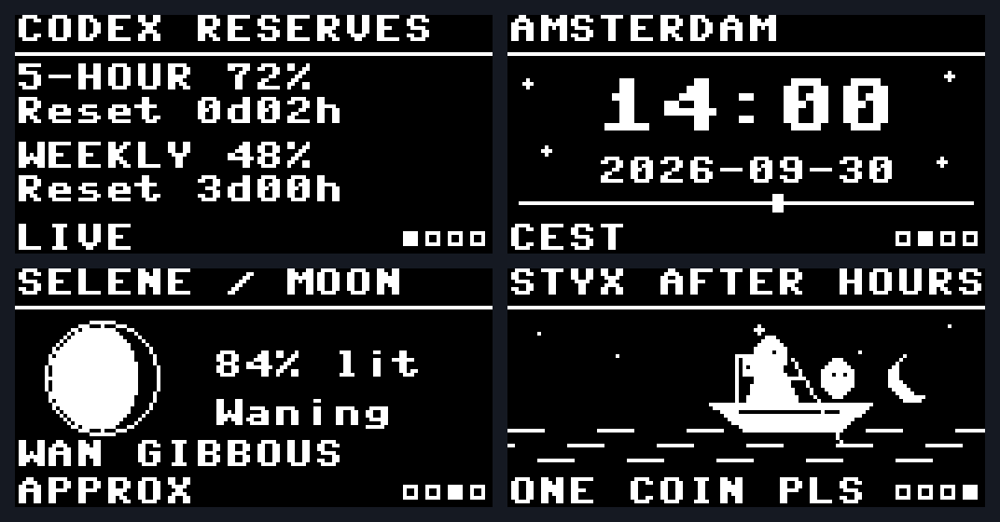

*Firmware preview · 2026-09-30. Firmware-rendered preview · not a device photograph*

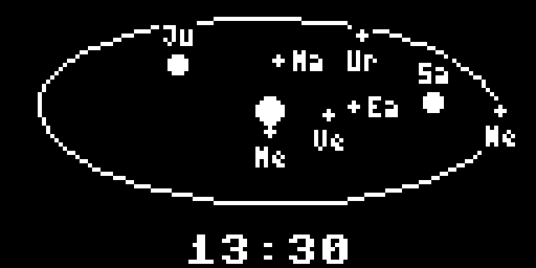

*Firmware preview · 2026-09-30. Firmware-rendered preview · not a device photograph*

## Hades Remote

A Windows animation client and owner-controlled relay for playing a fixed Hades visual on enrolled devices. The project combines installation packaging, a per-device command channel, a phone-oriented control surface and visible acknowledgement states.

**Type:** Windows client and controller · **Technologies:** PowerShell, Python, Windows, HTTPS relay

Source reviewed: 2026-10-27.

### The experience

Hades Remote is a small theatrical interaction: an owner can request a fixed animation on an enrolled Windows PC. The visual is the point of the application. The client is intentionally limited to its bundled playback and its own removal rather than providing an arbitrary remote shell or a personal-file transfer tool.

### The system

A Windows client contacts an HTTPS relay for its permitted commands. A separate controller manages playback requests and device status. The phone-oriented interface supports individual or grouped actions and shows queued or acknowledged results, so issuing a request is distinct from proving that the destination has performed it.

### Packaging and boundaries

The normal installer uses Windows components already present on supported desktops, while an optional Python package supports explicit scripted setup. Device tokens are encrypted for the installing account, and device credentials do not grant controller privileges. Removal has a confirmation flow and tracks acknowledgement; offline devices can remain pending. The project’s trust boundary depends on authorized enrollment, owner identity and the security of the devices and relay.

### Portfolio presentation

The current local distribution includes the 1.2.2 Windows installer. This portfolio shows the original animation artwork and a simplified system diagram. It deliberately omits the private controller address, device list, tokens and actual control screens. No installation, enrollment, broadcast or remote removal was performed to create this case study.

**Capabilities**

- Fixed bundled animation with local Escape dismissal
- Per-device enrollment and encrypted device tokens
- Owner-authenticated phone control
- Playback acknowledgement and removal status
- Windows installer plus optional Python integration

[Open project details](https://devilishdagon.github.io/portfolio/#project=hades-remote)

Original animation artwork and a public-safe system diagram reviewed 27 October 2026. No enrolled device identities, controller addresses or credentials are shown.

*Project artwork · 2026-10-20. Original bundled Hades visual; reviewed 27 October 2026.*

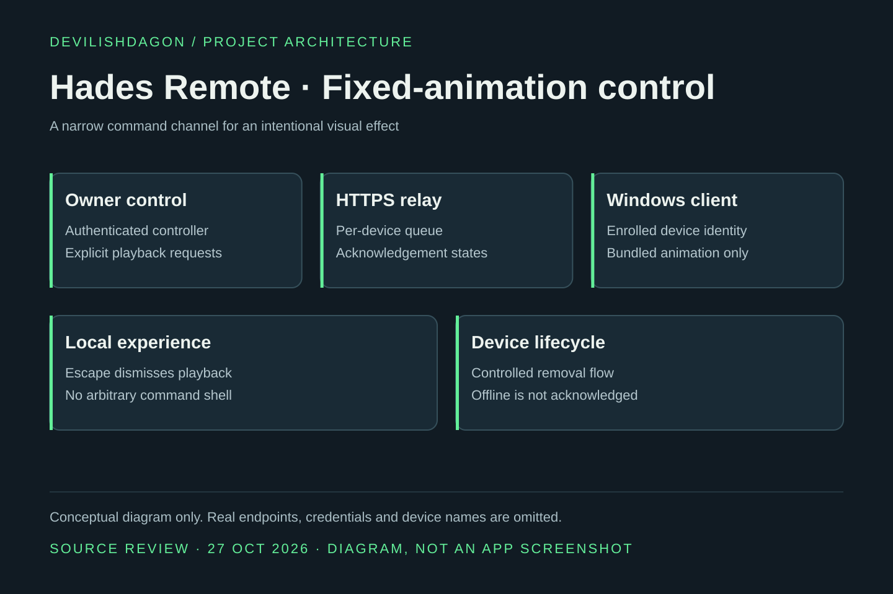

*Architecture diagram · 2026-10-27. Owner control, relay and enrolled client. No real endpoints or device identifiers.*

## Zagreus · Local AI

A self-hosted personal workspace with local model inference, chat history, memory review, evaluations and a Today view. Reviewed corrections can inform a separate preference-ranking model, with explicit promotion and rollback.

**Type:** Private application · **Technologies:** Python, SQLite, llama.cpp, JavaScript

**Capabilities**

- Local inference and persistent conversations
- Tasks, priorities and in-app reminders
- Reviewed feedback and controlled model changes

[Open project details](https://devilishdagon.github.io/portfolio/#project=zagreus-local)

Retained from the 5 October portfolio review. The date is shown so this is not mistaken for a newly captured interface.

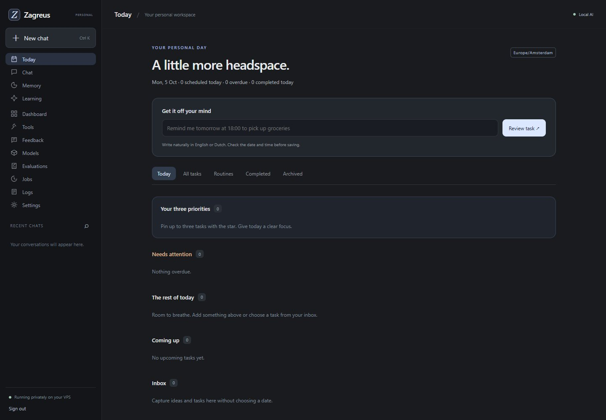

*Application screenshot · 2026-10-05. Application capture · isolated empty data*

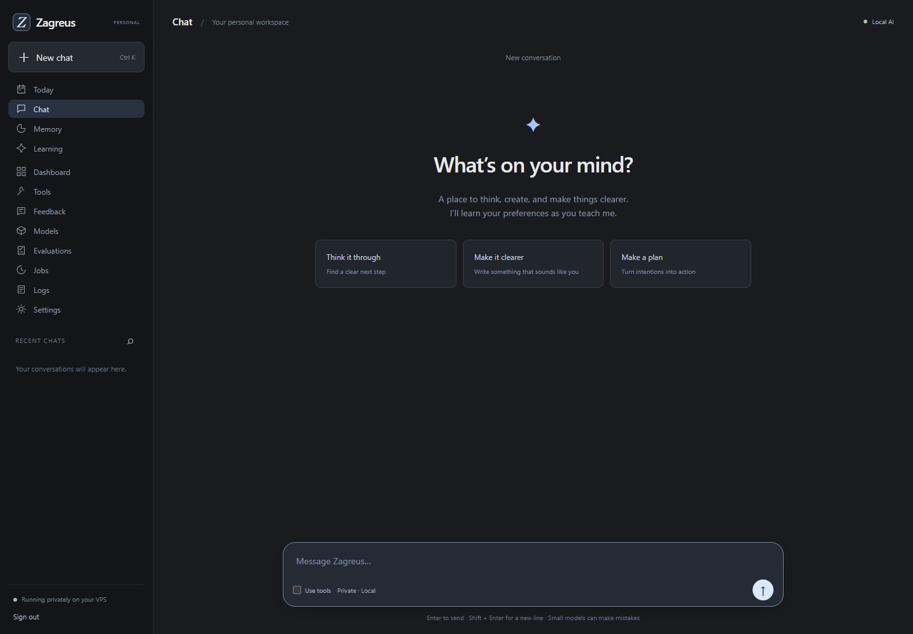

*Application screenshot · 2026-10-05. Application capture · isolated empty data*

## Night Shift

A minimalist browser game that starts at one occupied desk and branches into Order, Control or Irregularity. Each route changes the mechanics, events and long-term progression, with local saves and offline progress.

**Type:** Browser game · **Technologies:** JavaScript, HTML/CSS

Source reviewed: 2026-10-27.

**Capabilities**

- Three mechanically distinct doctrine routes
- Route-aware upgrades and prestige
- Local autosave and offline progression

[Open project details](https://devilishdagon.github.io/portfolio/#project=night-shift)

Retained from the 5 October portfolio review. The date is shown so this is not mistaken for a newly captured interface.

*Application screenshot · 2026-10-05. Application capture · fresh local playthrough*

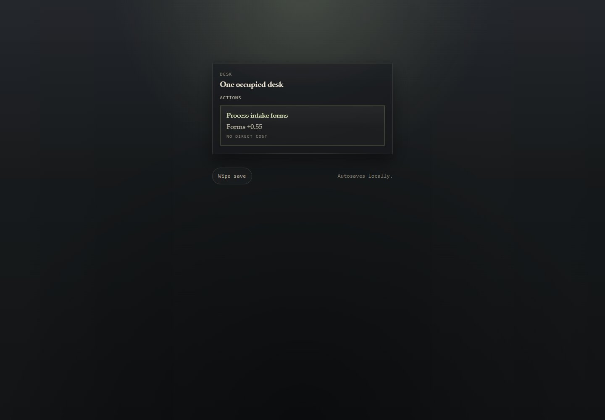

*Application screenshot · 2026-10-05. Application capture · fresh local playthrough*

## Expedition Ledger

A browser dashboard for a tabletop expedition. It tracks remaining distance, rations and backpack capacity, and applies the different costs and distances of normal and haste travel.

**Type:** Web application · **Technologies:** Python, Flask, JavaScript

**Capabilities**

- Travel actions with explicit ration costs
- Distance and inventory tracking
- Persistent local expedition state

[Open project details](https://devilishdagon.github.io/portfolio/#project=dnd-tracker)

Retained from the 5 October portfolio review. The date is shown so this is not mistaken for a newly captured interface.

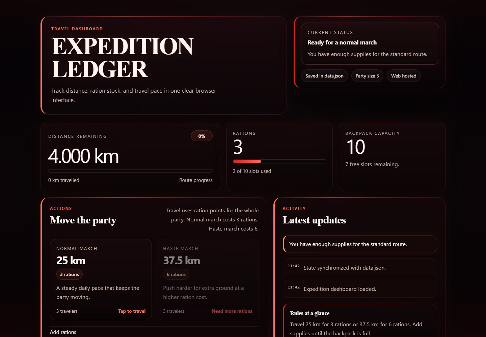

*Application screenshot · 2026-10-05. Application capture · default sample state*

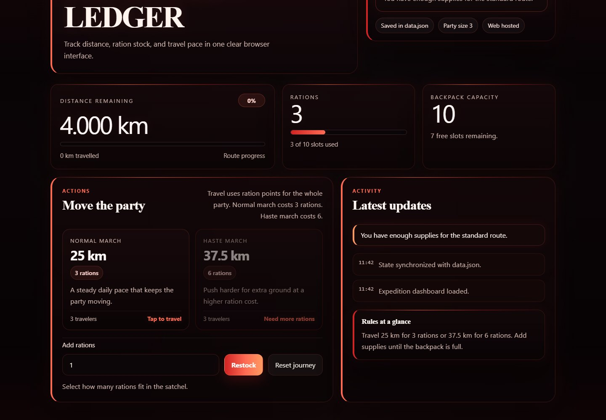

*Application screenshot · 2026-10-05. Application capture · default sample state*

## Xylem Kortingsregeling

A Windows application that reads an approved customer export and discount template, then produces a customer PDF, Excel copy and audit record. It validates daily data refreshes and handles ambiguous customer matches explicitly.

**Type:** Desktop application · **Technologies:** Python, Windows, Excel automation

**Capabilities**

- Validated customer lookup and scheme selection
- Branded PDF and Excel output
- Per-document audit trail

[Open project details](https://devilishdagon.github.io/portfolio/#project=discount-tool)

Public-safe documentation previews prepared on 5 October 2026. These are not screenshots of a running application.

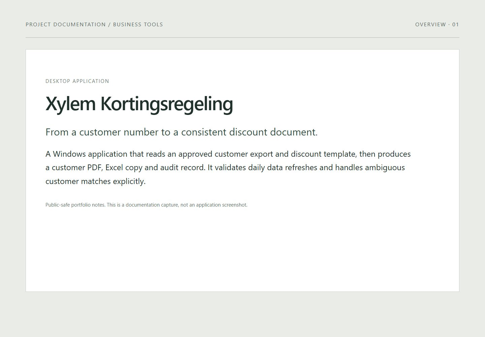

*Documentation preview · 2026-10-05. Documentation capture · public-safe project notes*

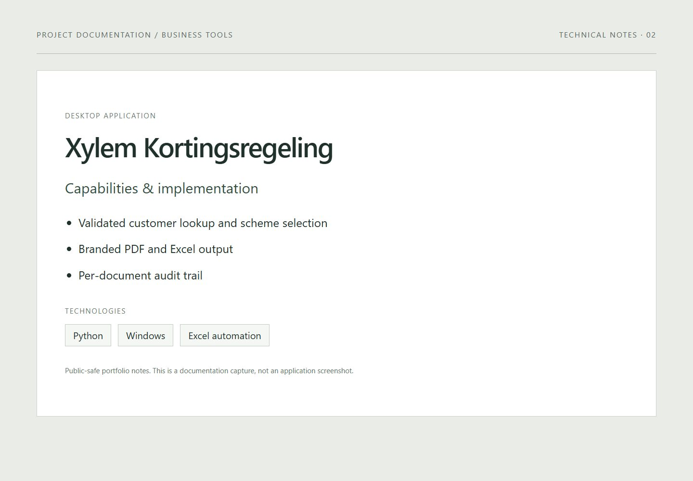

*Documentation preview · 2026-10-05. Documentation capture · public-safe project notes*

## Hermes

A compact recording workflow with a touchscreen-oriented interface. Hermes transcribes audio, produces summaries and can deliver recaps to Discord, with visible processing progress and temporary-file cleanup.

**Type:** Desktop application · **Technologies:** Python, Tkinter, Whisper, Raspberry Pi

Source reviewed: 2026-10-27.

**Capabilities**

- Record or import meeting audio
- Transcription and summary pipeline
- Compact interface for small displays

[Open project details](https://devilishdagon.github.io/portfolio/#project=hermes)

Public-safe documentation previews prepared on 5 October 2026. These are not screenshots of a running application.

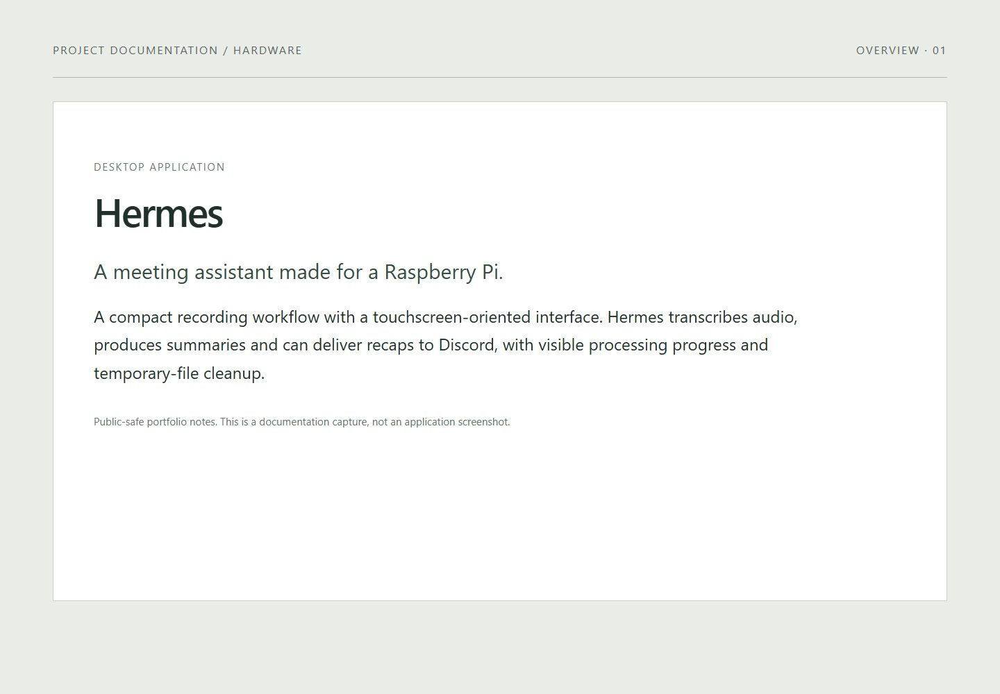

*Documentation preview · 2026-10-05. Documentation capture · public-safe project notes*

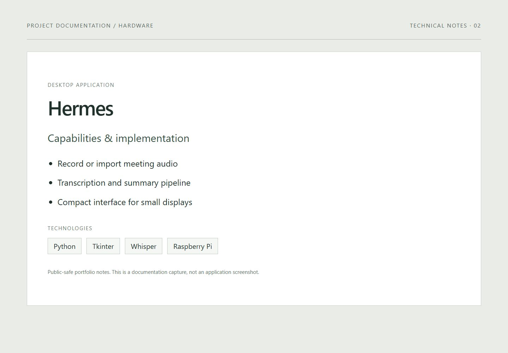

*Documentation preview · 2026-10-05. Documentation capture · public-safe project notes*

## Charon

A focused archival service that stores records, applies a retention gate and retrieves relevant material with identifiers and confidence information. PostgreSQL, vector search and raw object storage support durable recall.

**Type:** Backend service · **Technologies:** Python, FastAPI, PostgreSQL, pgvector

Source reviewed: 2026-10-27.

**Capabilities**

- Structured archival with retention filtering
- Ranked semantic retrieval
- Soft deletion with deliberate purge

[Open project details](https://devilishdagon.github.io/portfolio/#project=charon)

Public-safe documentation previews prepared on 5 October 2026. These are not screenshots of a running application.

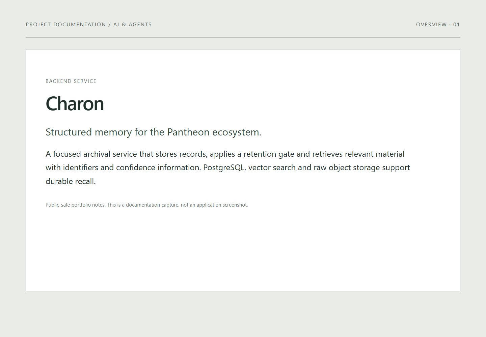

*Documentation preview · 2026-10-05. Documentation capture · public-safe project notes*

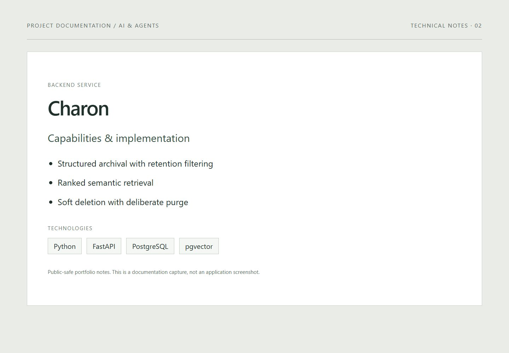

*Documentation preview · 2026-10-05. Documentation capture · public-safe project notes*

## Ananke

An experimental forecasting service that extracts structured features from events and models project risk, workload and routine trends. Forecasts carry a horizon, contributing factors and scenario information; this is a software experiment, not a validated clinical model.

**Type:** Experimental service · **Technologies:** Python, SQLite, Forecasting

**Capabilities**

- Deterministic feature extraction
- Probabilistic forecasts and contributing factors
- Recomputable snapshots from stored evidence

[Open project details](https://devilishdagon.github.io/portfolio/#project=ananke)

Public-safe documentation previews prepared on 5 October 2026. These are not screenshots of a running application.

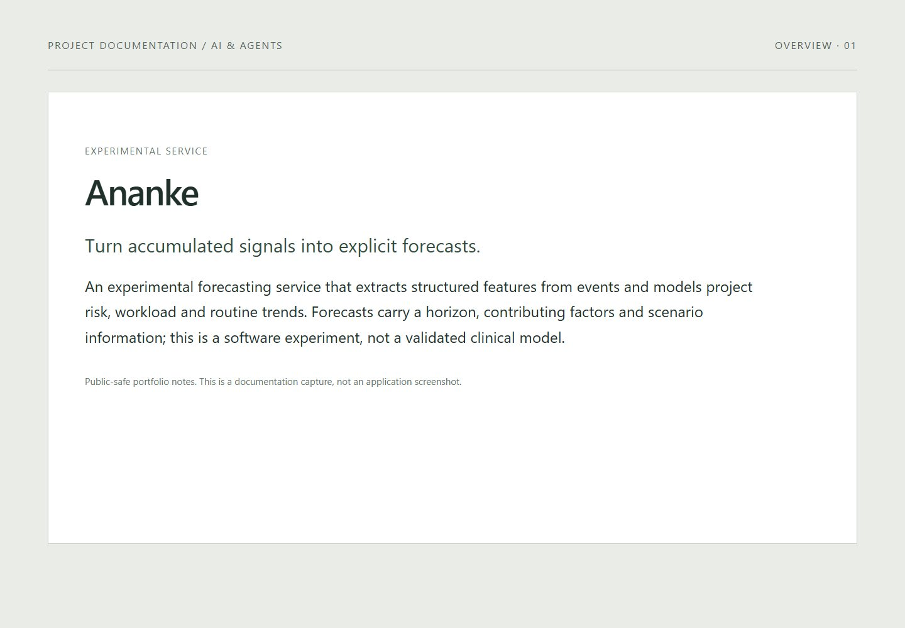

*Documentation preview · 2026-10-05. Documentation capture · public-safe project notes*

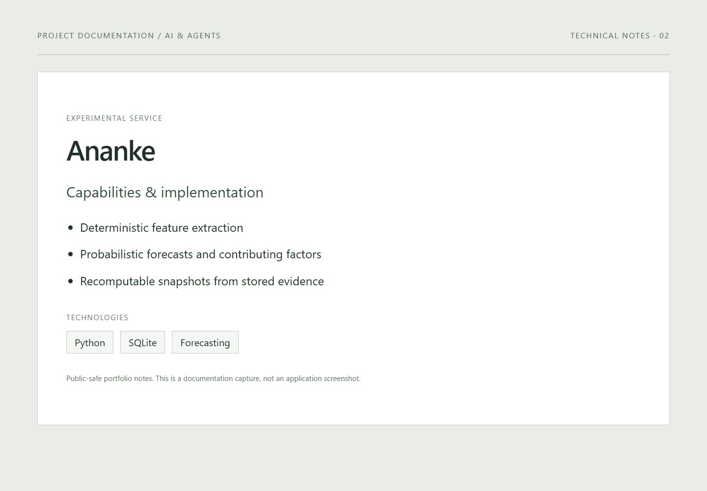

*Documentation preview · 2026-10-05. Documentation capture · public-safe project notes*

## Athena

The strategy layer of Pantheon. Athena takes Ananke forecast snapshots and creates a limited weekly intervention plan, preserving plan history and optionally storing readable plans in Charon.

**Type:** Backend prototype · **Technologies:** Python, SQLite, REST API

**Capabilities**

- Weekly planning from forecast snapshots
- Plan and intervention history
- Optional memory and notification integrations

[Open project details](https://devilishdagon.github.io/portfolio/#project=athena)

Public-safe documentation previews prepared on 5 October 2026. These are not screenshots of a running application.

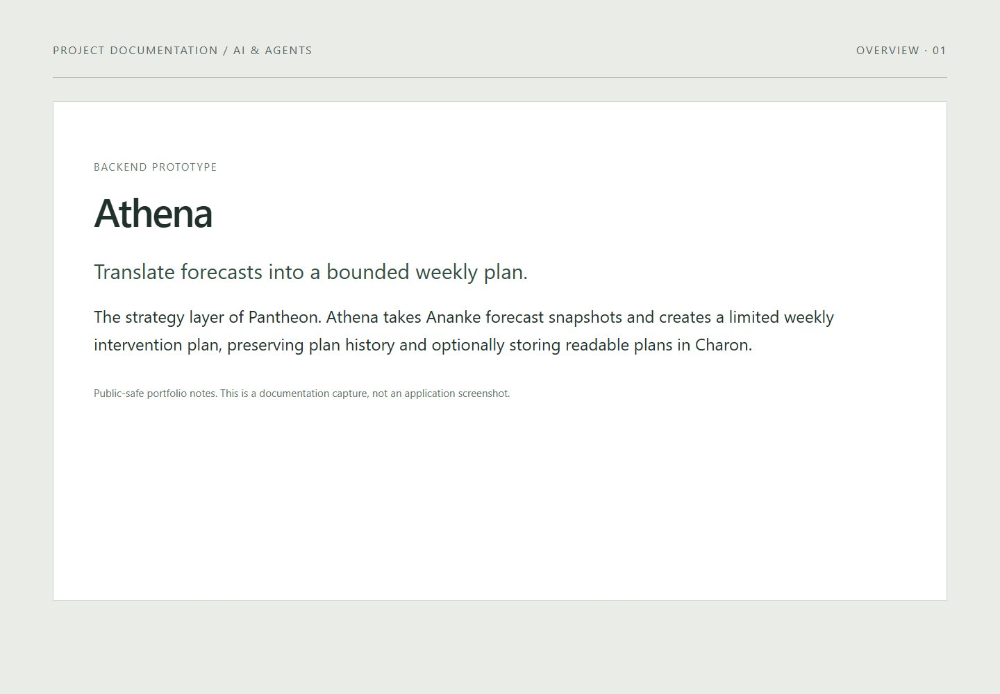

*Documentation preview · 2026-10-05. Documentation capture · public-safe project notes*

*Documentation preview · 2026-10-05. Documentation capture · public-safe project notes*

## Hypnos

A sleep-data ingestion tool that normalizes sessions from configurable providers, including SleepCloud, and passes records to Charon. Deduplication and stored state help avoid importing the same session repeatedly.

**Type:** Data integration · **Technologies:** Python, REST APIs, Charon

**Capabilities**

- Provider-based sleep session ingestion
- Normalized duration and quality fields
- Persistent deduplication state

[Open project details](https://devilishdagon.github.io/portfolio/#project=hypnos)

Public-safe documentation previews prepared on 5 October 2026. These are not screenshots of a running application.

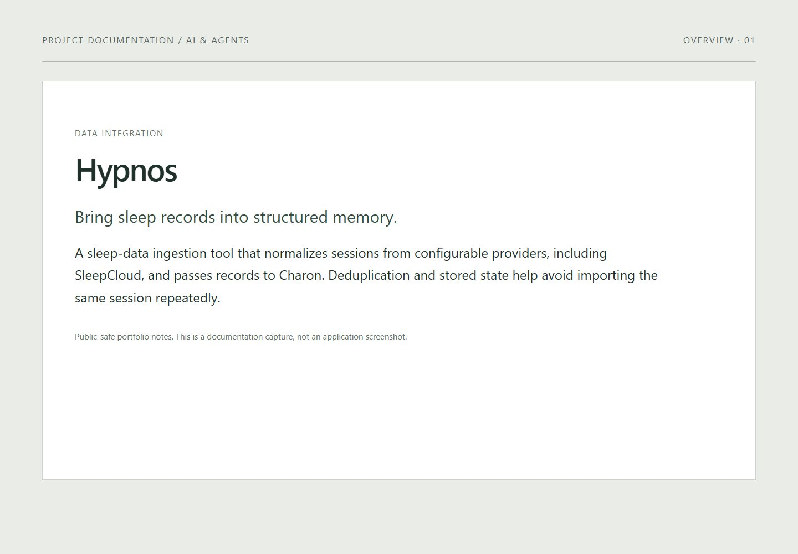

*Documentation preview · 2026-10-05. Documentation capture · public-safe project notes*

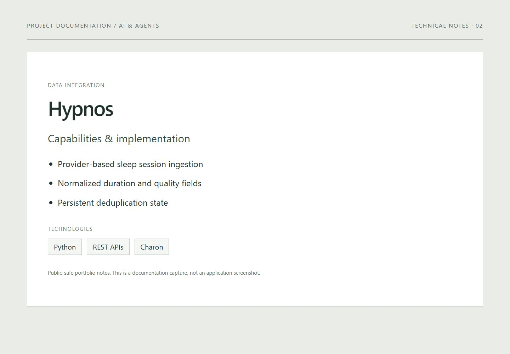

*Documentation preview · 2026-10-05. Documentation capture · public-safe project notes*

## Helios

A FastAPI and HTMX dashboard that receives service heartbeats and displays health states. It gives the Pantheon ecosystem a common place to inspect online, offline and degraded services.

**Type:** Monitoring service · **Technologies:** Python, FastAPI, HTMX, SQLAlchemy

Source reviewed: 2026-10-27.

**Capabilities**

- Service heartbeat collection
- Status summaries and health endpoints
- Lightweight operational dashboard

[Open project details](https://devilishdagon.github.io/portfolio/#project=helios)

Retained from the 5 October portfolio review. The date is shown so this is not mistaken for a newly captured interface.

*Application screenshot · 2026-10-05. Application capture · isolated empty data*

*Application screenshot · 2026-10-05. Application capture · isolated empty data*

## Clio

A small tool that gathers GitHub activity for a date and turns it into a Markdown report. It separates provider access, configuration and report generation so a daily development summary is easy to produce.

**Type:** Developer utility · **Technologies:** Python, GitHub API, Markdown

Source reviewed: 2026-10-27.

**Capabilities**

- Date-based Git activity collection
- Readable Markdown reports
- Configurable reporting pipeline

[Open project details](https://devilishdagon.github.io/portfolio/#project=clio)

Public-safe documentation previews prepared on 5 October 2026. These are not screenshots of a running application.

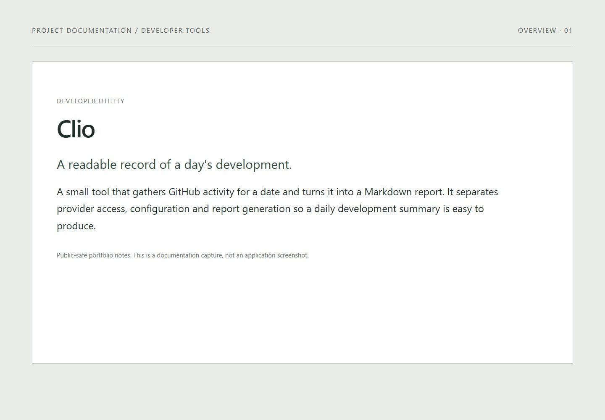

*Documentation preview · 2026-10-05. Documentation capture · public-safe project notes*

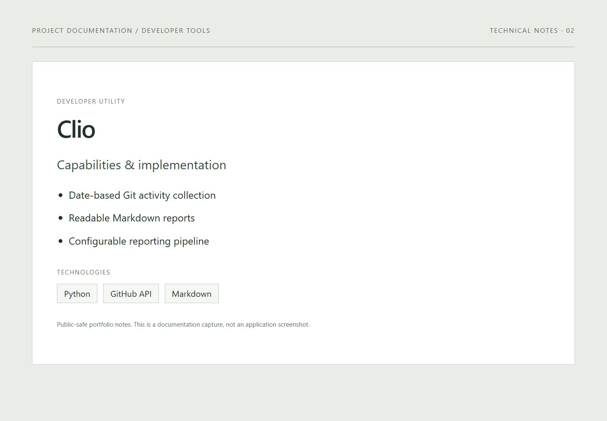

*Documentation preview · 2026-10-05. Documentation capture · public-safe project notes*

## Prometheus

A self-hosted Discord bot for managing NPCs, locations and loose plot hooks. Slash commands and a lightweight dashboard help a game master organize narrative information stored in local JSON files.

**Type:** Private application · **Technologies:** Python, Discord.py, FastAPI, JSON

Source reviewed: 2026-10-27.

**Capabilities**

- NPC and location records
- Plot-hook tracking through Discord
- Lightweight management dashboard

[Open project details](https://devilishdagon.github.io/portfolio/#project=prometheus)

Retained from the 5 October portfolio review. The date is shown so this is not mistaken for a newly captured interface.

*Application screenshot · 2026-10-05. Application capture · isolated empty data*

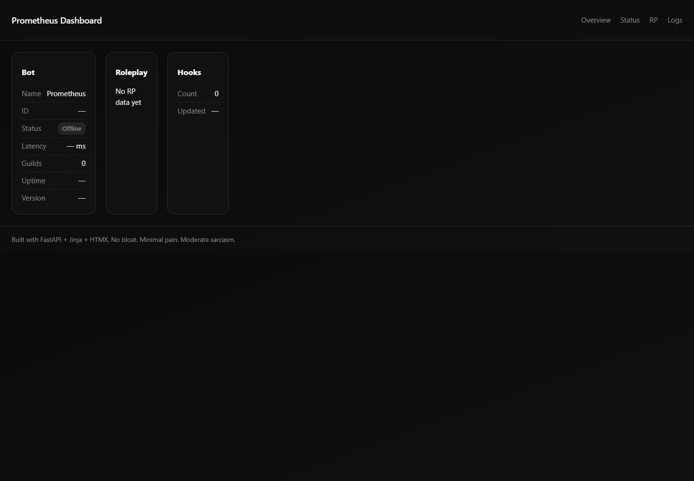

*Application screenshot · 2026-10-05. Application capture · isolated empty data*

## Pantheon Mobile

A native Android app with an all-bots overview and individual service tabs. It polls status endpoints and exposes configurable actions, with confirmation dialogs and response previews.

**Type:** Android application · **Technologies:** Kotlin, Android, Jetpack Compose

Source reviewed: 2026-10-27.

**Capabilities**

- All-bots dashboard and per-bot tabs
- Configurable status checks
- Confirmed actions and response previews

[Open project details](https://devilishdagon.github.io/portfolio/#project=pantheon-mobile)

Public-safe documentation previews prepared on 5 October 2026. These are not screenshots of a running application.

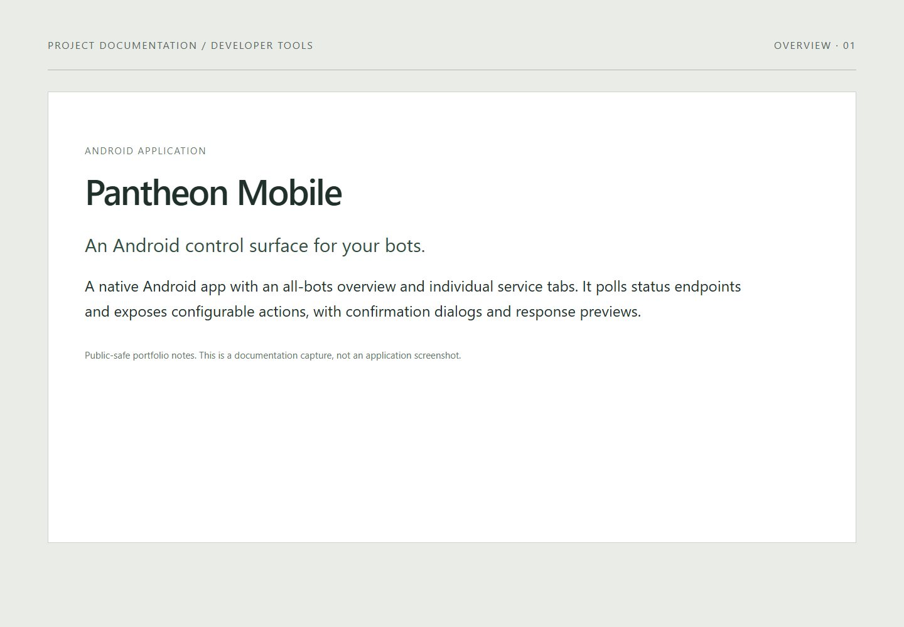

*Documentation preview · 2026-10-05. Documentation capture · public-safe project notes*

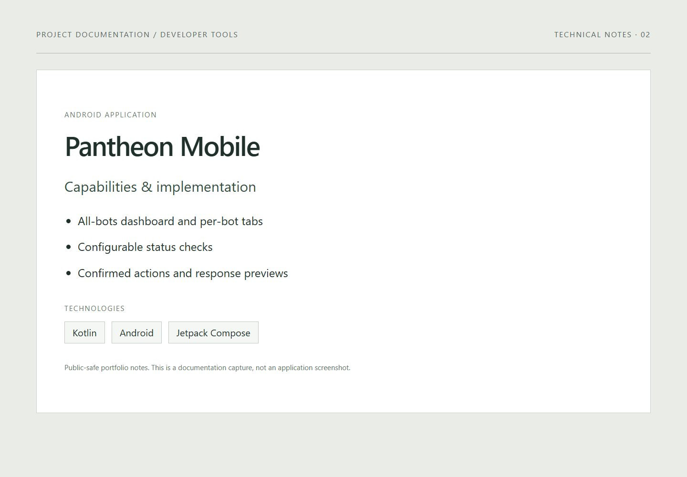

*Documentation preview · 2026-10-05. Documentation capture · public-safe project notes*

## Pantheon Core

A small Python package that centralizes the common pieces used by Pantheon bots: heartbeat integration, configuration loading, logging and shared status types.

**Type:** Developer library · **Technologies:** Python, Shared library

**Capabilities**

- Common heartbeat client
- Shared configuration and logging helpers
- Consistent service status types

[Open project details](https://devilishdagon.github.io/portfolio/#project=pantheon-core)

Public-safe documentation previews prepared on 5 October 2026. These are not screenshots of a running application.

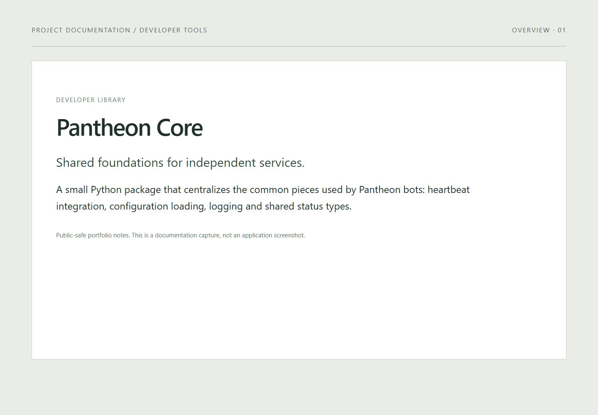

*Documentation preview · 2026-10-05. Documentation capture · public-safe project notes*

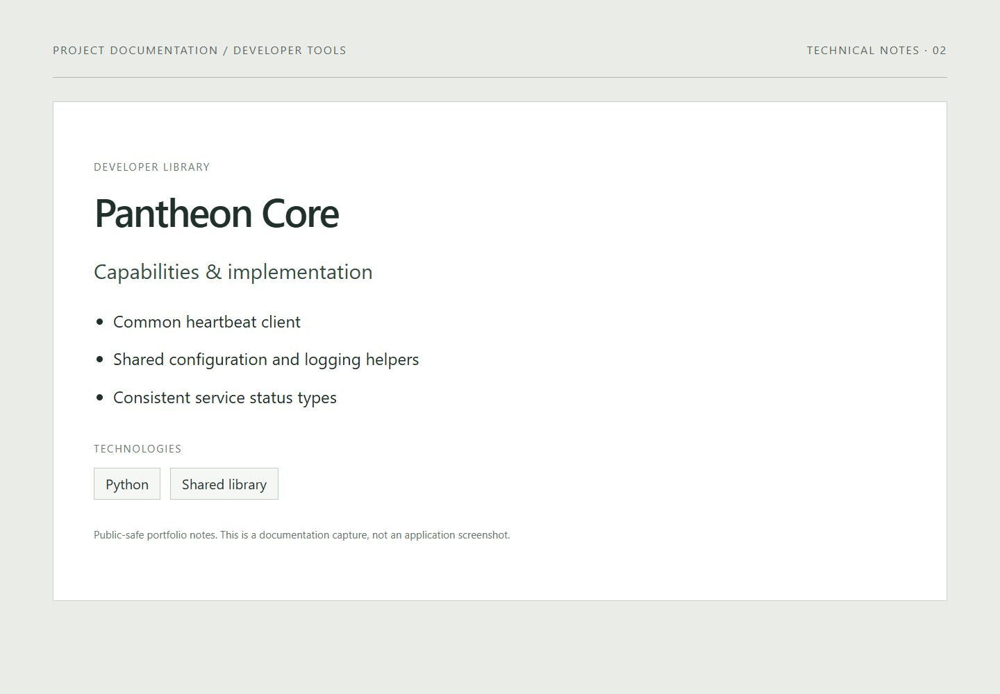

*Documentation preview · 2026-10-05. Documentation capture · public-safe project notes*

## Face Locker

A face-recognition module for the DaVinci smart locker project. It combines camera input, facial encodings, user management and locker control with a Python desktop interface.

**Type:** Hardware application · **Technologies:** Python, OpenCV, Tkinter

**Capabilities**

- Face encoding and identity matching
- Camera and desktop interface integration
- User and locker management

[Open project details](https://devilishdagon.github.io/portfolio/#project=face-locker)

Public-safe documentation previews prepared on 5 October 2026. These are not screenshots of a running application.

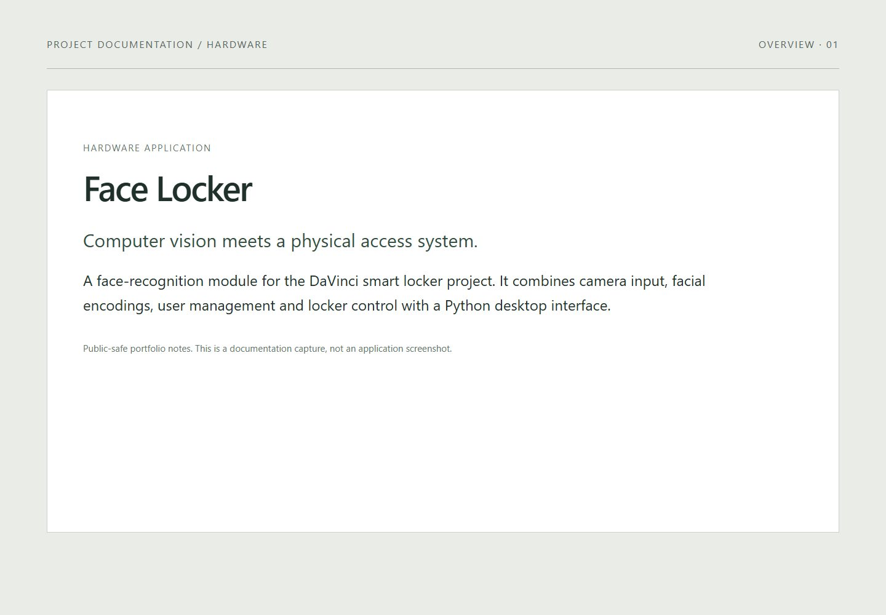

*Documentation preview · 2026-10-05. Documentation capture · public-safe project notes*

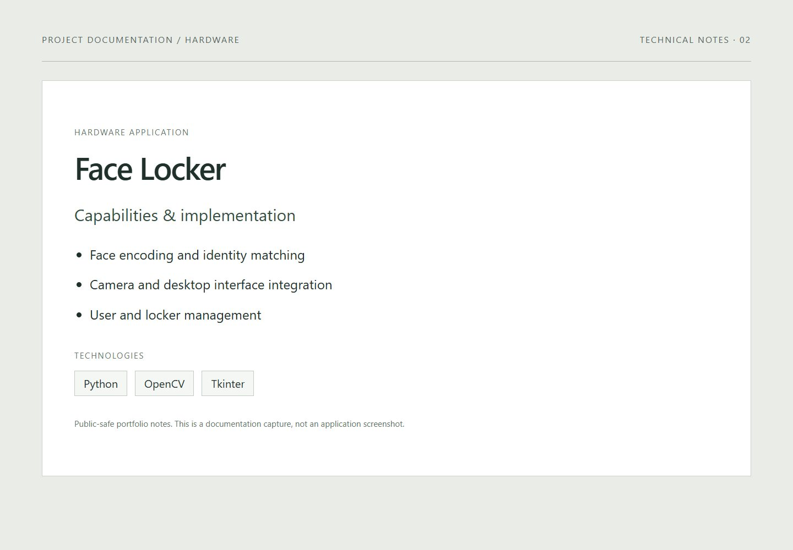

*Documentation preview · 2026-10-05. Documentation capture · public-safe project notes*

## Exchange Grid Autopilot

An automated trading prototype with a paper mode, persistent positions and configurable exposure limits. It implements a mean-reversion grid and records events in SQLite. No performance or profitability claims are made.

**Type:** Experimental utility · **Technologies:** Python, SQLite, CCXT

Source reviewed: 2026-10-27.

**Capabilities**

- Paper-mode experimentation
- Persistent open and closed positions
- Exposure, cooldown and loss limits

[Open project details](https://devilishdagon.github.io/portfolio/#project=grid-autopilot)

Public-safe documentation previews prepared on 5 October 2026. These are not screenshots of a running application.

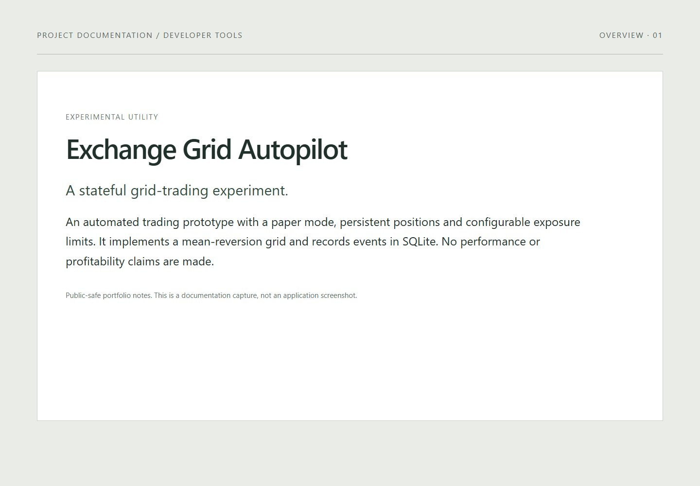

*Documentation preview · 2026-10-05. Documentation capture · public-safe project notes*

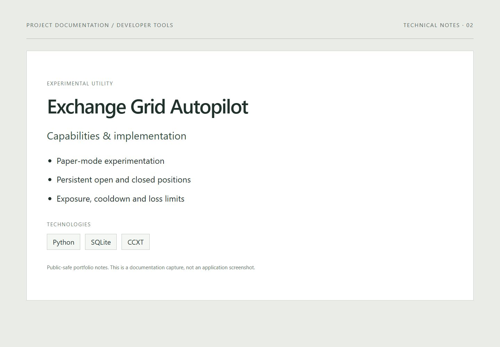

*Documentation preview · 2026-10-05. Documentation capture · public-safe project notes*

## Discord AI Bot Template

A compact Python template that responds to Discord mentions and keeps the last ten messages per channel as short-term context. It is a starting point for further bot development.

**Type:** Starter template · **Technologies:** Python, Discord.py, OpenAI

Source reviewed: 2026-10-27.

**Capabilities**

- Mention-triggered responses
- Per-channel short-term context
- Small, readable project structure

[Open project details](https://devilishdagon.github.io/portfolio/#project=discord-template)

Public-safe documentation previews prepared on 5 October 2026. These are not screenshots of a running application.

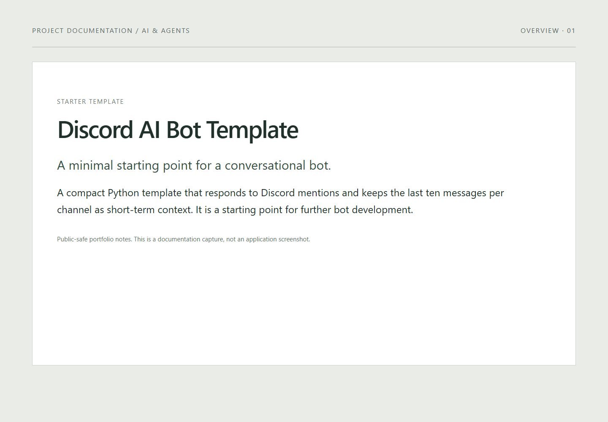

*Documentation preview · 2026-10-05. Documentation capture · public-safe project notes*

*Documentation preview · 2026-10-05. Documentation capture · public-safe project notes*

## Zagreus · Discord

The earlier Zagreus agent connects a conversational core to calendar, weather and Discord adapters. A separate heartbeat integration reports service lifecycle and health to Helios.

**Type:** Earlier project · **Technologies:** Python, Discord, Calendar API

Source reviewed: 2026-10-27.

**Capabilities**

- Conversational core with tool adapters
- Calendar and weather integrations
- Helios heartbeat reporting

[Open project details](https://devilishdagon.github.io/portfolio/#project=zagreus-bot)

Public-safe documentation previews prepared on 5 October 2026. These are not screenshots of a running application.

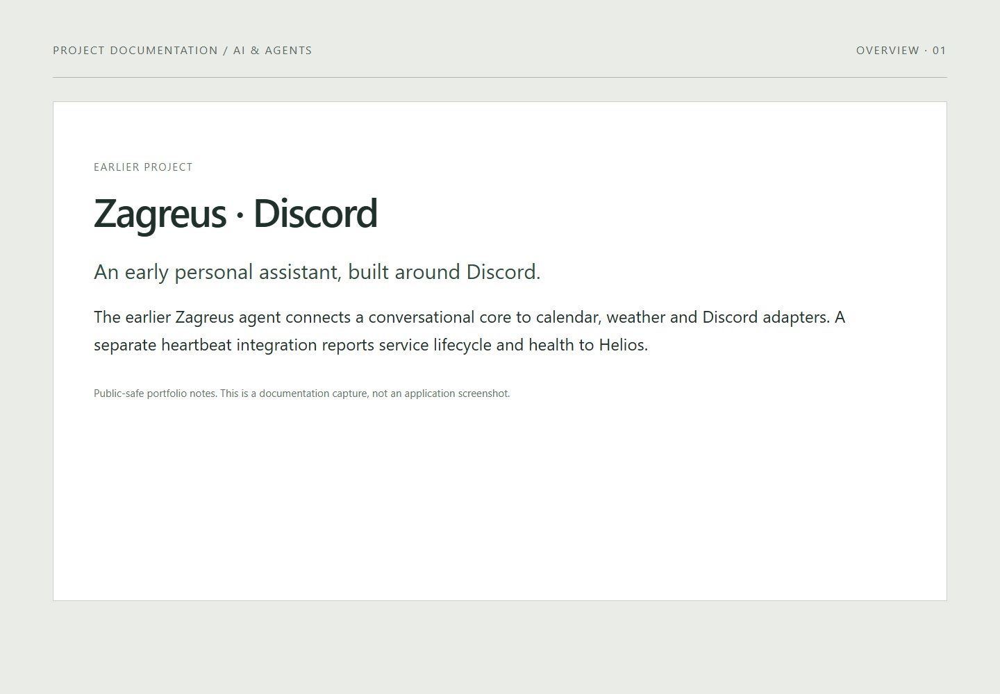

*Documentation preview · 2026-10-05. Documentation capture · public-safe project notes*

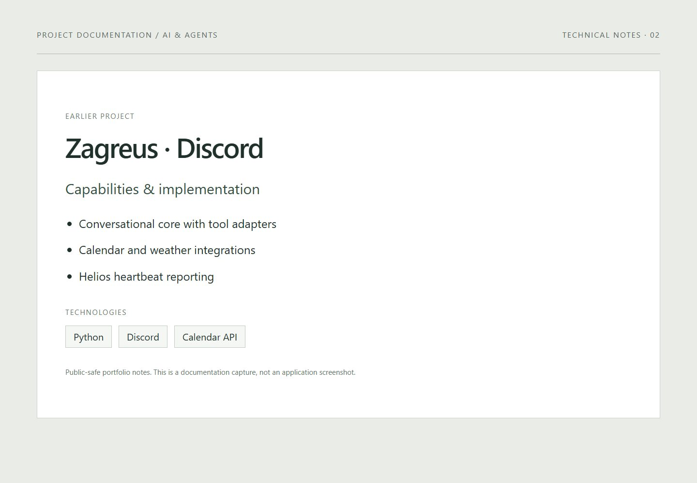

*Documentation preview · 2026-10-05. Documentation capture · public-safe project notes*

## Metis Public Site

A compact public site explaining how Metis turns plans from conversations into reviewable appointments. It also provides the project's privacy information and contact route.

**Type:** Public website · **Technologies:** HTML, CSS

**Capabilities**

- Product explanation and appointment flow
- Privacy information
- Responsive, lightweight presentation

[Open project details](https://devilishdagon.github.io/portfolio/#project=metis-public-site)

Retained from the 5 October portfolio review. The date is shown so this is not mistaken for a newly captured interface.

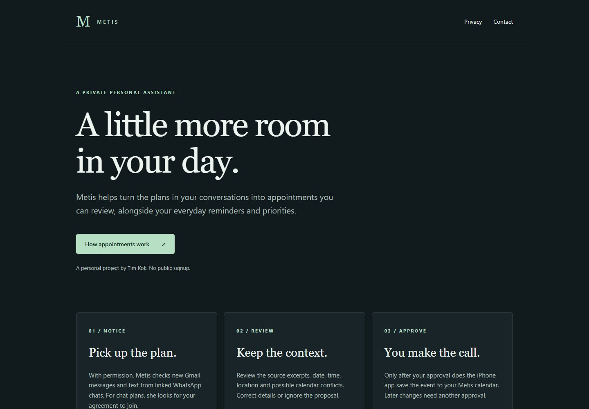

*Application screenshot · 2026-10-05. Website capture*

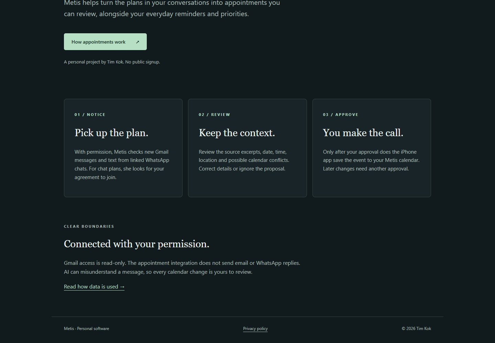

*Application screenshot · 2026-10-05. Website capture*

## Network Configuration Automation

A Python automation tool for a device-management workflow. It reads an equipment list, checks prerequisites, applies configuration steps and records per-device outcomes in Excel.

**Type:** Internal automation · **Technologies:** Python, Selenium, OpenPyXL

**Capabilities**

- Spreadsheet-driven device processing
- Precondition checks and recovery steps
- Immediate per-device outcome logging

[Open project details](https://devilishdagon.github.io/portfolio/#project=xylem-ip)

Public-safe documentation previews prepared on 5 October 2026. These are not screenshots of a running application.

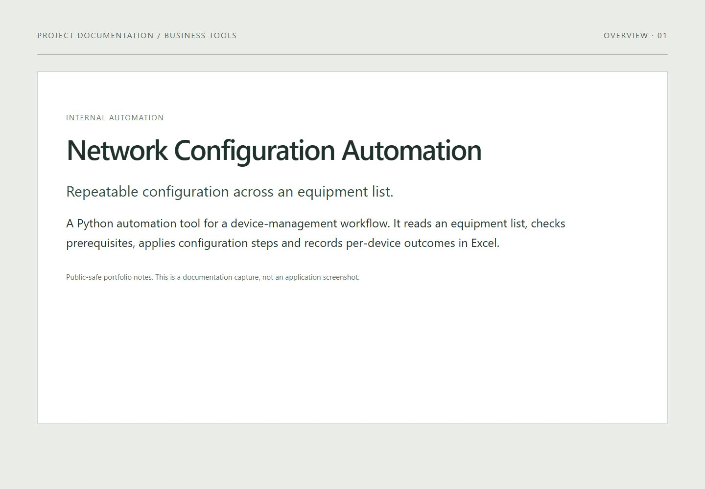

*Documentation preview · 2026-10-05. Documentation capture · public-safe project notes*

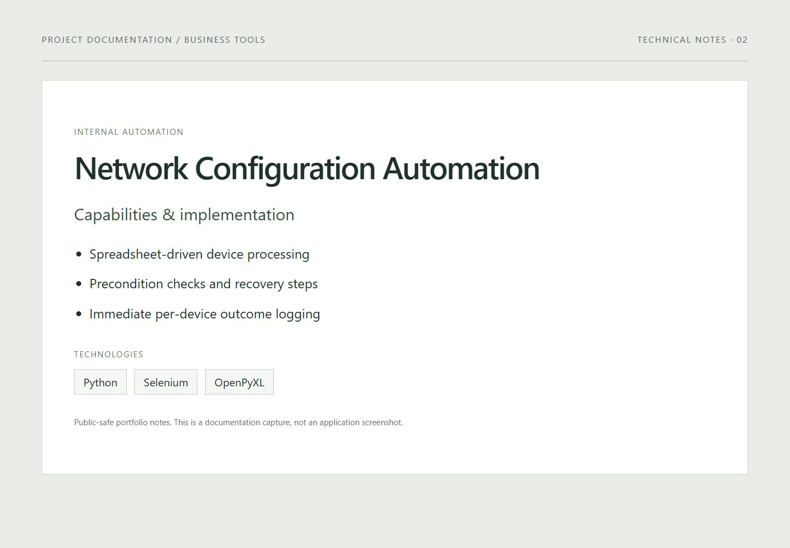

*Documentation preview · 2026-10-05. Documentation capture · public-safe project notes*

## Modbus Configuration Uploader

A device-configuration utility that reuses an authenticated browser session to upload a CSV configuration and apply it. Results are recorded in CSV and, when configured, in the source tracking workbook.

**Type:** Internal automation · **Technologies:** Python, Selenium, Requests

**Capabilities**

- Batch configuration upload and apply
- Session-aware request handling
- CSV and Excel outcome tracking

[Open project details](https://devilishdagon.github.io/portfolio/#project=xylem-modbus)

Public-safe documentation previews prepared on 5 October 2026. These are not screenshots of a running application.

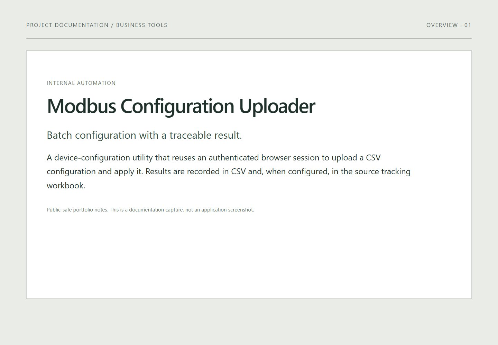

*Documentation preview · 2026-10-05. Documentation capture · public-safe project notes*

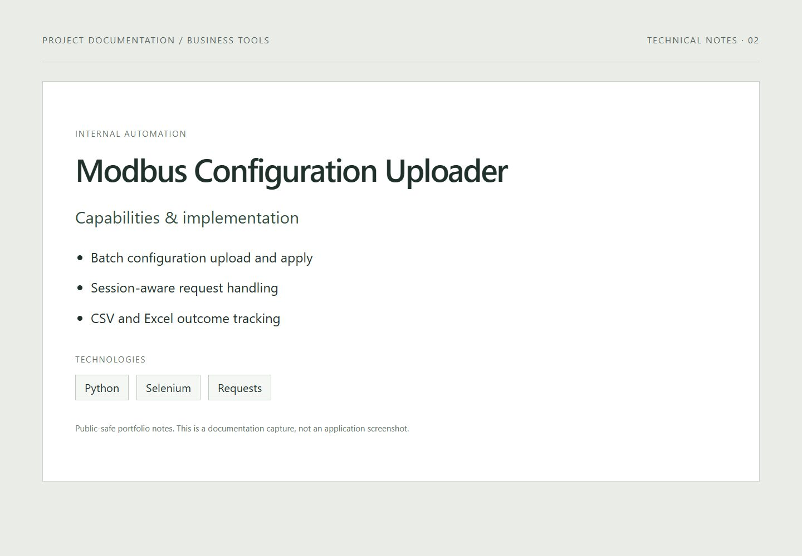

*Documentation preview · 2026-10-05. Documentation capture · public-safe project notes*

## Advantech Firmware Updater

A Python maintenance utility for processing a list of industrial routers, navigating their management interface and recording firmware-update outcomes. It is presented without device addresses or credentials.

**Type:** Internal utility · **Technologies:** Python, Selenium, Excel

**Capabilities**

- Spreadsheet-driven device selection
- Firmware upload workflow
- Per-device progress and result logging

[Open project details](https://devilishdagon.github.io/portfolio/#project=firmware-updater)

Public-safe documentation previews prepared on 5 October 2026. These are not screenshots of a running application.

*Documentation preview · 2026-10-05. Documentation capture · public-safe project notes*

*Documentation preview · 2026-10-05. Documentation capture · public-safe project notes*

## Advantech Reboot Tool

A batch utility that reads devices from Excel or CSV, handles management-interface login and performs a reboot workflow with time limits and per-device results.

**Type:** Internal utility · **Technologies:** Python, Selenium, CSV

**Capabilities**

- Excel and CSV input
- Per-device timeout handling
- Logged reboot outcomes

[Open project details](https://devilishdagon.github.io/portfolio/#project=router-reboot)

Public-safe documentation previews prepared on 5 October 2026. These are not screenshots of a running application.

*Documentation preview · 2026-10-05. Documentation capture · public-safe project notes*

*Documentation preview · 2026-10-05. Documentation capture · public-safe project notes*

## Equipment List Reconciler

A PySide6 desktop tool for working with equipment spreadsheets. It uses configurable keys, including IP-address columns, and a table-based interface for reviewing and reconciling records.

**Type:** Desktop utility · **Technologies:** Python, PySide6, pandas

**Capabilities**

- Spreadsheet-based input
- Configurable record-matching keys
- Table views and progress reporting

[Open project details](https://devilishdagon.github.io/portfolio/#project=spreadsheet-reconcile)

Public-safe documentation previews prepared on 5 October 2026. These are not screenshots of a running application.

*Documentation preview · 2026-10-05. Documentation capture · public-safe project notes*

*Documentation preview · 2026-10-05. Documentation capture · public-safe project notes*

## This Portfolio

A static portfolio collecting software, hardware and automation projects in one searchable gallery. Project descriptions, technology notes and clearly labelled captures are published independently of private application source code.

**Type:** Public website · **Technologies:** HTML, CSS, JavaScript, GitHub Pages

Source reviewed: 2026-10-27.

**Capabilities**

- Category filters and project search
- Project detail and screenshot galleries
- Static publishing on GitHub Pages

[Open project details](https://devilishdagon.github.io/portfolio/#project=portfolio)

Current portfolio captured locally on 27 October 2026, including the expanded case-study section.

*Website screenshot · 2026-10-27. The current portfolio introduction.*

*Website screenshot · 2026-10-27. The expanded selected-work section and featured case studies.*

## Maintenance

Edit `projects.json`, then run `node scripts/build-directory.mjs` and `node scripts/check.mjs`. The site uses plain HTML, CSS and JavaScript. GitHub Pages publishes the root of `main`. Read [maintenance guidance](MAINTENANCE.md) before publishing.
